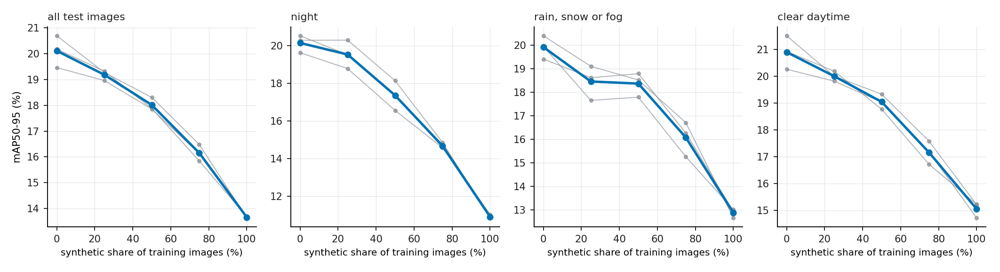
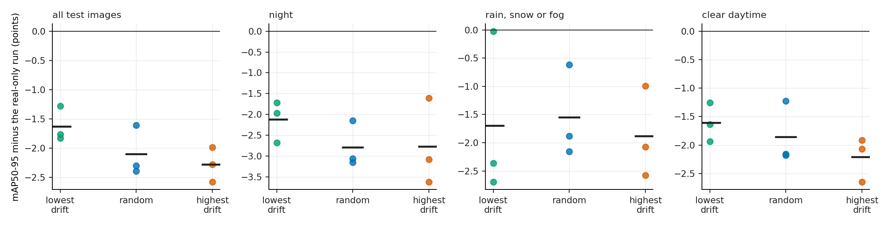
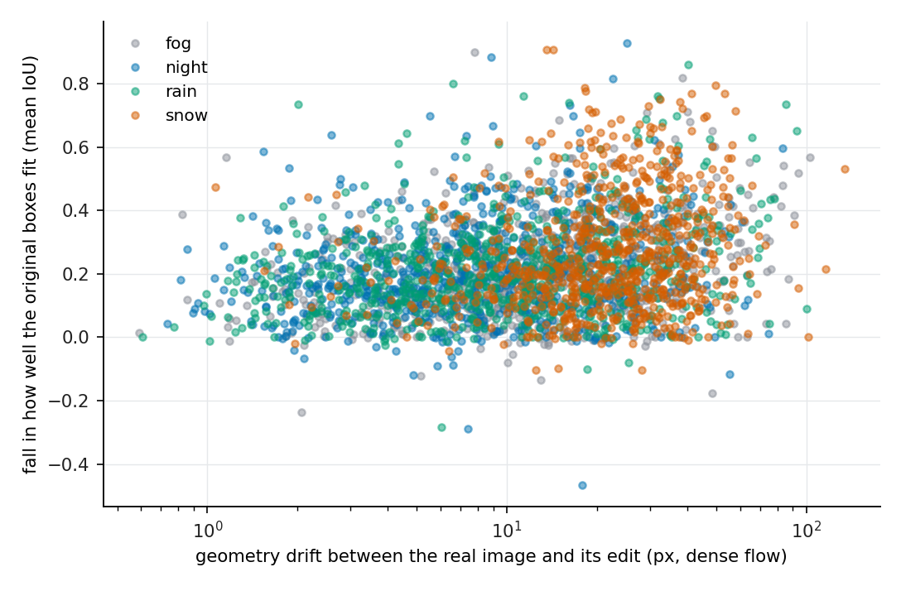

# synth-mix

**How much generated weather imagery should go into a detector's training set, and does a geometry-drift check tell you which generated images to keep?** I generated 3,000 fog, night, rain and snow versions of real BDD100K street images with a depth- and edge-guided image generator, scored how far each one moved the scene geometry, and trained YOLOv8 detectors on controlled mixes of real and generated images, always testing on held-out real images.



## At a glance

| question | answer |
|---|---|
| Does swapping real training images for generated ones help? | No: mAP50-95 falls steadily, from **20.1** (real only) to **13.7** (all generated); night is hit hardest (20.1 to 10.9). |
| Does adding generated images to a full real set help? | No detectable change: **-0.05** points [-1.9, +1.8] for +1,000 images. |
| Does it matter which generated images you keep? | Yes: at a 50% mix, the low-drift half beats the high-drift half by **+0.65** points [+0.34, +0.97]. |
| Does a geometry-drift score flag damaged labels? | Moderately: Spearman **0.24** over 2,977 images; least-drifted quarter loses 0.155 mean IoU, most-drifted 0.260. |

All 31 training runs ran on Kaggle's free GPUs (YOLOv8n and YOLOv8s, 20 epochs, 3 seeds); every number comes from them and is in [`results/results.md`](results/results.md). Differences are paired by seed with 95% t-intervals.

## What I did

- **Data.** The BDD100K validation split (9,992 street images with 7 road-user classes: car, truck, bus, pedestrian, rider, bicycle, motorcycle; 124,234 boxes), resized to 640x360. Split **by video** so no clip appears in two sets: 5,944 train, 979 validation, 3,069 test images. The test set includes 1,195 night images, 486 in rain, snow or fog, and 1,070 clear daytime images, so I can report each condition separately.
- **Synthetic images.** 3,000 random training images each get one edit (750 per weather type): Stable Diffusion 1.5 guided by a depth map (Depth Anything V2) and a Canny edge map through two ControlNets, 25 steps, so the layout stays put. The source image's boxes are reused as the labels of the edit, which is only valid if nothing moved.
- **Drift score.** For every real/edited pair I measured how far the scene moved with dense optical flow (median displacement over textured pixels, in pixels at 640 px width), using the metrics from my driving-geometry project. Median drift: 7.9 px for night, 9.6 for rain, 12.9 for fog and 22.5 for snow; across all 3,000 images the quartiles are 6.1 and 24.2 px.
- **Experiments (YOLOv8, COCO-pretrained, 20 epochs, 640 px, 3 seeds).**
  1. **Mixing rate.** A fixed budget of 3,000 training images, of which 0%, 25%, 50%, 75% or 100% are synthetic. Within a seed the mixes are nested and share the same randomness, so differences come from the synthetic share and not from drawing different real images.
  2. **Added synthetic data.** 3,000 real images plus 1,000 or 3,000 extra synthetic ones.
  3. **Which synthetic images.** At a 50% mix, the half with the lowest drift against the half with the highest drift, chosen separately inside each weather type so the weather mix is identical.
  4. **Model size.** YOLOv8n against YOLOv8s at 0% and 50% synthetic.
  5. **Does drift predict label damage?** A detector trained on real images only is run on each synthetic image; I measure how well the source image's boxes still fit what it finds (mean IoU of the best same-class detection) and correlate the fall with the drift score.
- **Test metric.** mAP50-95 on the real test images, overall and for night, rain/snow/fog and clear daytime; differences are paired by seed with 95% t-intervals.

## Results

**1. Replacing real images with generated ones lowers accuracy, and the loss grows with the share.** YOLOv8n, 3,000 training images per run, mAP50-95 on the held-out real test images (3,069 real photos; the columns are subsets of them):


| synthetic share | all test images | night | rain, snow or fog | clear daytime |
|---|---|---|---|---|
| 0% (real only) | 20.1 | 20.1 | 19.9 | 20.9 |
| 25% | 19.2 (-0.9, [-2.1, +0.2]) | 19.5 | 18.5 | 20.0 |
| 50% | 18.0 (-2.1, [-3.2, -1.0]) | 17.4 (-2.8) | 18.4 (-1.6) | 19.0 (-1.9) |
| 75% | 16.2 (-4.0, [-5.3, -2.6]) | 14.7 (-5.5) | 16.1 (-3.8) | 17.2 (-3.7) |
| 100% | 13.7 (-6.5, [-8.0, -4.9]) | 10.9 (-9.2) | 12.9 (-7.0) | 15.1 (-5.8) |

Night is hit hardest, even though night images are a quarter of what was generated: a detector trained only on generated night scenes scores 10.9 on real night images against 20.1 for the real-only detector.

**2. Adding generated images to a full real set did not help.** 3,000 real plus 1,000 generated: -0.05 points [-1.9, +1.8] against 3,000 real alone; plus 3,000 generated: -0.13 [-2.1, +1.9]. Rain, snow and fog moved by +0.4 [-1.6, +2.3] and -0.6 [-3.8, +2.6]: no detectable gain anywhere with three seeds.

**3. Which generated images you keep matters: the low-drift half beats the high-drift half.** At a 50% mix with the same weather balance, using the half of the generated images that moved the scene least gives mAP50-95 higher by **+0.65 points [+0.34, +0.97]** than using the half that moved it most, and +0.47 [+0.16, +0.79] higher than a random half (the high-drift half is -0.18 [-0.67, +0.31] against random). Against a real-only detector the low-drift half is still -1.6 points [-2.4, -0.9].



**4. The drift score tracks label damage, moderately.** A real-only detector was run on each of 2,977 generated images that have boxes; for each I measured how well the original boxes still fit what it finds. The fall in mean IoU rises with drift (Spearman 0.24, p < 1e-40; edge precision -0.24, SIFT-based drift 0.13, rotation 0.15). The quarter of images with the least drift lose 0.155 mean IoU; the quarter with the most lose 0.260. Snow, the weather with the most drift (median 22.4 px), loses most (0.231); night, with the least (7.8 px), loses 0.187. Part of this fall is legitimate (fog genuinely hides far objects), so it is an upper bound on label error.



**5. The cost does not depend on model size.** At a 50% mix YOLOv8n falls from 19.8 to 17.9 and YOLOv8s from 24.7 to 22.7 (about -2.0 points each; 2 seeds).

## How it was built

```
BDD100K (FiftyOne copy) -> data.py (640x360 YOLO files, split by video)
   -> generate_modal.py (SD 1.5 + depth + canny ControlNets, on a GPU) -> post_generate.py (copy labels)
   -> drift_score.py (dense optical-flow drift per pair)
   -> specs.py (nested real + synthetic mixes) -> runner.py (train + evaluate on any GPU machine)
   -> report.py (tables and figures from results/runs/*.json)
```

- Every parameter is in `configs/default.toml`.
- 7 automated tests on the experiment design: the split is by video and disjoint, only training images are ever used for training, fixed-budget runs have equal size and never contain both a real image and its own edit, mixes are nested within a seed, the weather mix is balanced, and the low-drift selection really has lower drift than the high-drift one.
- The images were generated on Modal (about 3 GPU-hours); the training grid ran on Kaggle (`kaggle/`): a script kernel that trains on every GPU it can see, with one data copy per GPU, and skips finished runs on a restart.

## Limits

- The edited images keep the labels of their source image. The drift score and the label-damage check measure whether that is reasonable; they do not make it true. A night edit can legitimately hide a pedestrian that the label still marks.
- Test images come from the same dataset, with the same camera and cities, as the training images; the test is held out by video, not by city or camera.
- Three seeds (two for the model-size comparison) give wide intervals; differences below the width of those intervals should not be read as effects, and the added-data comparison in particular cannot rule out a small gain or loss.
- The drift filter picks images by a score that is also correlated with the weather type; I balanced the weather mix inside each selection, but the low-drift images are still the visually simpler ones (an effect of 0.65 points is small next to the 2-point cost of a 50% mix).
- To fit Kaggle's 12-hour session limit I train for 20 epochs, use YOLOv8n and YOLOv8s only, and keep 3,000 images per run.
- The images are BDD100K (BSD-3-Clause) and the edits are derived from them; neither is redistributed here.

## Reproduce

Data: BDD100K validation split (10,000 street images; [Yu et al., CVPR 2020](https://arxiv.org/abs/1805.04687), BSD-3-Clause). `data/bdd/` must hold
`images/`, `manifest.csv` and `samples.json`; the helper in [driving-geometry](https://github.com/sriyaaa2003/driving-geometry) builds them
(`python -m dgeo.curation.prepare_bdd --out data/bdd`). Images and generated edits are not redistributed here.

```bash
pip install -e ".[dev,generate,train,drift]"
python -m synthmix.data                                    # 640x360 YOLO dataset, split by video
modal run src/synthmix/generate_modal.py                   # GPU: 3,000 weather edits (about 3 GPU-hours)
python -m synthmix.post_generate && python -m synthmix.drift_score && python -m synthmix.specs
python src/synthmix/runner.py --data data --specs data/specs_all.json --out results/runs --deadline-hours 10   # GPU
python -m synthmix.report && pytest
```

On Kaggle's free T4 GPUs see [`kaggle/`](kaggle/README.md). The generation settings (SD 1.5, depth and Canny ControlNets, 25 steps) and every
other parameter are in `configs/default.toml`.

## Related projects

Four studies on the safety validation of automated driving, all on real data: [AFALS](https://github.com/sriyaaa2003/afals) (falsifying the assumptions of a safety-proven cruise controller), [risk-predictors](https://github.com/sriyaaa2003/risk-predictors) (how much data a safety metric needs), [cutin-atlas](https://github.com/sriyaaa2003/cutin-atlas) (parameterizing, clustering and efficiently simulating real cut-ins) and **synth-mix** (this one). The drift metrics come from [driving-geometry](https://github.com/sriyaaa2003/driving-geometry).

## License

MIT, see [LICENSE](LICENSE). BDD100K is under its own terms.
